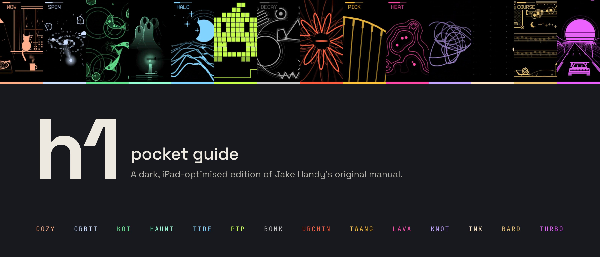
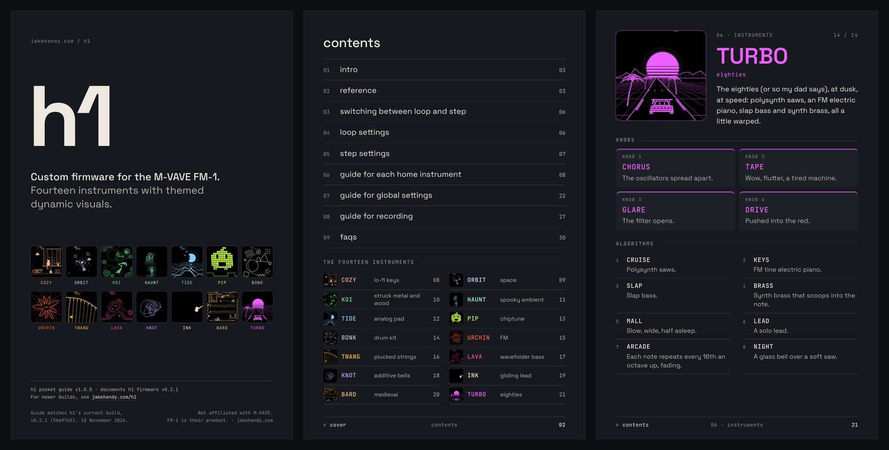

  

  
  

*A dark, iPad-optimised edition of Jake Handy's original manual for [h1](https://github.com/jakehandy/h1), the free custom firmware that turns the M-VAVE FM-1 into fourteen instruments.*

Same words, same artwork, laid out for comfortable reading on an iPad mini in portrait: one page per instrument, a tappable contents page, bookmarks, and links on every page.

> **Which firmware does this describe?**
> This PDF documents **h1 v0.2.1** (build 5b697e5, 18 November 2026). h1 is changing quickly. If your FM-1 runs a newer h1, the instructions here may be out of date, so check Jake's live guide at **[jakehandy.com/h1](https://jakehandy.com/h1)**, which is always the authority. Every PDF has its firmware version on the cover, on the last page and in its filename.

## A look inside

  

## Download

| | Version | Download |
| --- | --- | --- |
| **PDF** (iPad mini, 30 pages) | Guide v1.0.0 · h1 v0.2.1 | [h1-pocket-guide-v1.0.0-h1-v0.2.1.pdf](https://github.com/slowphase/h1-pocket-guide/raw/main/downloads/h1-pocket-guide-v1.0.0-h1-v0.2.1.pdf) |
| **Editable source** | Guide v1.0.0 · h1 v0.2.1 | [h1-pocket-guide-v1.0.0-h1-v0.2.1-source.zip](https://github.com/slowphase/h1-pocket-guide/raw/main/downloads/h1-pocket-guide-v1.0.0-h1-v0.2.1-source.zip) |

The same source is in the [`source/`](source/) folder, with build instructions in [`source/README.md`](source/README.md). Every edition is kept in [`downloads/`](downloads/), named with its guide and firmware versions, so an older PDF is never mistaken for the current one.

## Version numbers

There are two, and they mean different things:

| | |
| --- | --- |
| **Guide version** (v1.0.0) | This edition's layout. It changes when the PDF is revised. |
| **Firmware documented** (h1 v0.2.1) | The h1 build Jake's text describes. A new guide release follows when the text is updated for a newer h1. |

## The firmware

h1 is made by **Jake Handy**. Install and update it with his official instructions, not this guide.

- [h1 on GitHub](https://github.com/jakehandy/h1) (source, releases and install notes)
- [h1 on The Firmware Hub](https://thefirmwarehub.com/firmware/h1/) (install from Chrome or Edge)
- [The original guide](https://jakehandy.com/h1) and the [browser simulator](https://jakehandy.com/public/h1/simulator.html)

## Credits

- **Jake Handy** wrote h1 and the guide. All the text, the instrument artwork and the screenshots in this PDF are his, reproduced without changes. Only the layout is new.
- Layout by slowphase, set in Space Grotesk and JetBrains Mono (SIL Open Font License 1.1), with AI assistance (Claude, by Anthropic). Design notes and the full list of source differences are in [`source/NOTES.md`](source/NOTES.md).

This is an unofficial, independent edition. It isn't made or endorsed by Jake Handy or M-VAVE. If something here doesn't match h1 or the original guide, please [open an issue](https://github.com/slowphase/h1-pocket-guide/issues).

Licence details: [LICENSE.md](LICENSE.md).

"M-VAVE" and "FM-1" are trademarks of their owners and are used here only to describe the product.
